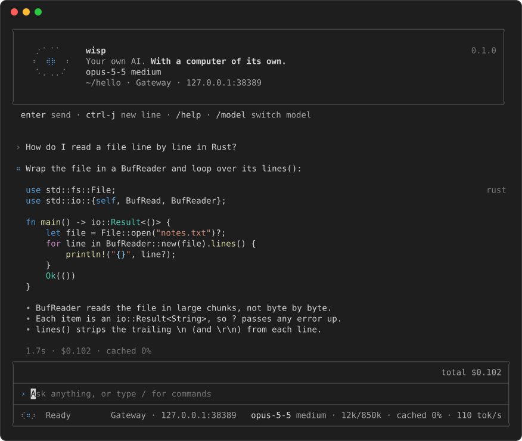
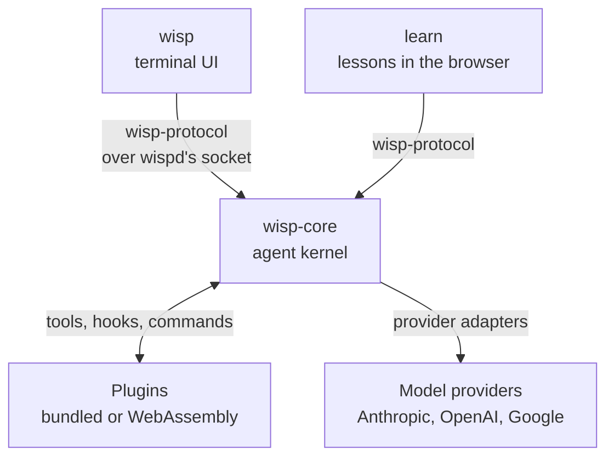

<h1 align="center">Wisp</h1>

<p align="center">
  An open AI assistant for the terminal that isn't tied to one model provider,<br>
  built on a headless agent kernel written in Rust.
</p>

<p align="center">
  
  <br>
  <sub>Wisp running against a local test server; the reply and usage figures are sample data.</sub>
</p>

## Why

- **One assistant, many providers.** Use Claude, OpenAI and Gemini models
  through a subscription you already have or an API key, and switch between
  them in the middle of a chat.
- **Careful with cost.** Wisp keeps reusable prompt text stable where it can,
  so the provider's prompt cache can reuse it. It flags cache misses, naming
  the cause when it can, and shows the estimated cost of each turn and session.
- **Agents that delegate.** The assistant can start named child agents, message
  them and collect their reports, and you can open any agent's chat.
- **Built from plugins.** Every tool comes from a plugin, bundled or loaded as
  WebAssembly, on one documented plugin API.

## What works today

- A full-screen terminal chat with Markdown, highlighted code and diffs.
- Sign-in with a Claude, ChatGPT or Antigravity (Gemini) subscription, or an
  API key for Claude, OpenAI, Gemini or a compatible gateway.
- Switching account, model and thinking effort mid-chat with `/account`,
  `/model` and `/effort`.
- Tools for the model: shell commands and background processes, reading files,
  web search, a checklist, and multiple-choice questions to you.
- Child agents, each with its own chat, shown on the Agents page (`/agents` or
  Ctrl-T).
- MCP servers (`/mcp`), Agent Skills folders and project instructions from
  `AGENTS.md`.
- Rewinding to an earlier message (`/rewind`) and compacting a long chat
  (`/compact`, or automatically as the context fills).
- Pasting or attaching images.
- Chats that keep running after you close the terminal; reopen one with
  `wisp --resume`.
- An append-only log of each session by default, and `--output jsonl` for
  scripts.
- Bundled plugins you can switch with `wisp plugin`, and WebAssembly plugins
  added with `wisp plugin add`.
- `learn`, a separate app that runs lessons in the browser, with voice and an
  interactive board.

## Quick start

These steps are for Linux, including WSL on Windows. Install Rust with
`rustup`, plus CMake, a C compiler and `make`. The checkout pins the
[Rust toolchain](rust-toolchain.toml).

From a local checkout, install the `wisp` command, then start a chat:

```sh
cargo install --locked --path crates/wisp-cli
wisp
```

If Wisp doesn't find an account or key, it asks you to sign in with a
subscription or enter an API key. In a chat, `/help` lists commands and keys,
and `/account` manages your accounts. `wisp doctor` prints what Wisp detected,
for bug reports.

The learning app installs the same way, with
`cargo install --locked --path apps/learn`; [its page](docs/learn.md) covers
running it.

## How it's built

Wisp.Core is a headless kernel, and every frontend is a client of it: clients
send commands and read events, defined once in `wisp-protocol`. By default, a
full-screen chat runs its kernel in a host process of its own, so the chat
keeps running after its terminal closes.



Each provider is a bundled plugin you can switch off; its adapter still lives in
the kernel and moves into the plugin later (planned). The crates and their
roles are listed in [AGENTS.md](AGENTS.md#architecture).

## Documentation

| Topic | Pages |
|---|---|
| Using Wisp | [Commands and keys](docs/commands.md), [accounts](docs/endpoints.md), [settings](docs/settings.md), [context and compaction](docs/context.md), [rewind](docs/rewind.md) |
| Agents and tools | [Agents](docs/agents.md), [tools](docs/tools.md), [MCP](docs/mcp.md), [skills](docs/skills.md), [running sessions](docs/daemon.md) |
| Providers and cost | [OpenAI](docs/openai.md), [Gemini](docs/gemini.md), [pricing](docs/pricing.md) |
| Extending | [Plugins](docs/plugins.md) |
| Learning app | [Learn](docs/learn.md), [voice](docs/voice.md) |
| Internals | [Architecture design](docs/architecture.md), [session log](docs/session-log.md), [testing](docs/testing.md) |

## Status

Wisp is in development.

- The shell tool runs commands without asking first, so run Wisp where that is
  acceptable.
- Agents that run a project follow written instructions for handing off work
  and running checks ([projects flow](flows/projects/FLOW.md)). Enforcing those
  steps in the kernel, with checks run by code, is planned.
- Wisp aims to be one assistant across chat, projects, coding, desktop work,
  voice and bots. Desktop work and bots are planned.

## Contributing

Read [CONTRIBUTING.md](CONTRIBUTING.md) before you open a pull request: it
covers commit titles, squash merges and the checks to run. The project's rules,
for people and AI agents alike, are in [AGENTS.md](AGENTS.md).

Report a vulnerability privately, as [SECURITY.md](SECURITY.md) describes,
never in a public issue or pull request.

## Licence

Wisp is licensed under the [MIT License](LICENSE).
